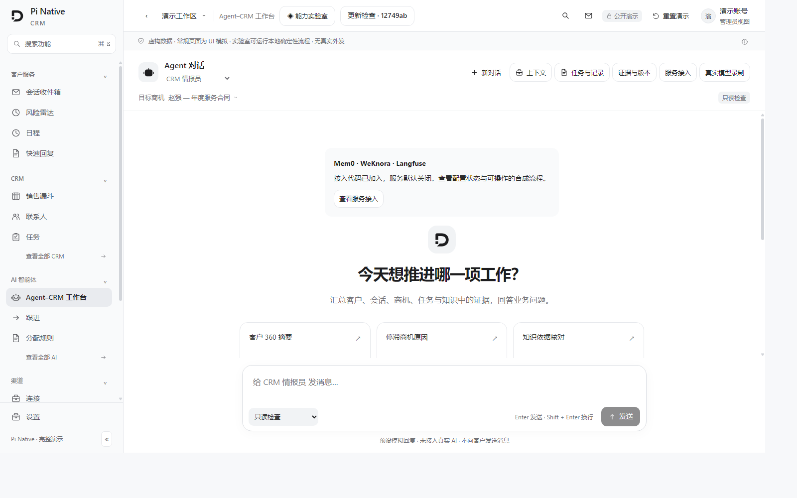
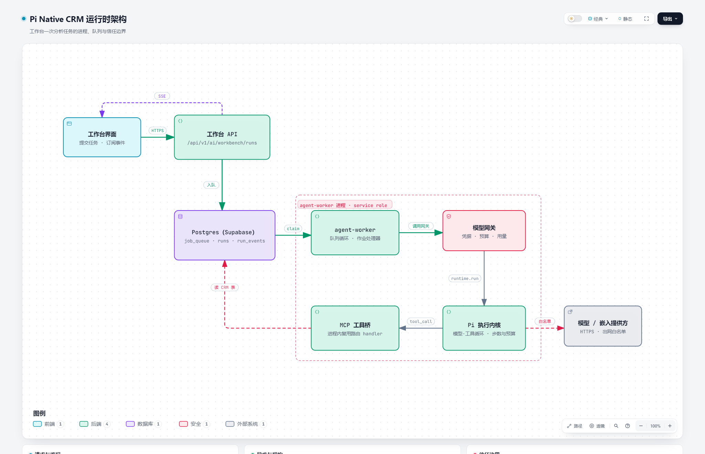
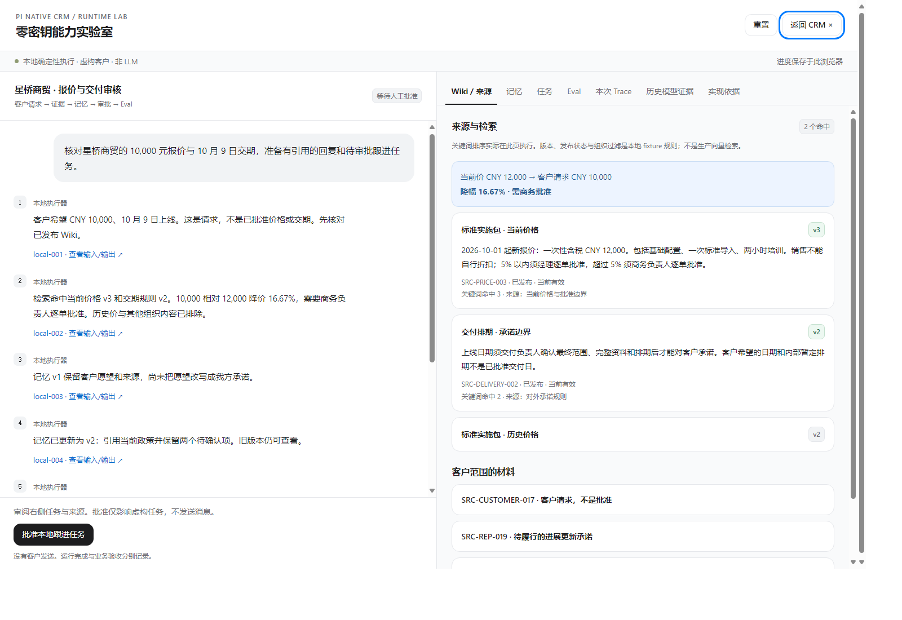

# Pi Native CRM

以真实 CRM 为状态空间的 Agent 原生工作台。

Agent 读取客户与商机，消费知识与记忆，通过受治理的工具推进业务；人能看到它做了什么、依据什么，以及 CRM 发生了哪些变化。

[在线演示](https://pi-native-crm.app.workbuddy.host/?sharecode=ATEVGXWN6Y) · [演示站源码](examples/chat-first-demo) · [架构说明](docs/architecture) · [更新日志](CHANGELOG.md) · [原始项目说明](docs/PROJECT-README.md)



---

## 这个仓库怎么读

这是一个**分层归档仓库**，不是逐日提交记录的复刻。提交按架构依赖顺序组织成十层，每层回答一个问题："到这一层为止，系统能说清什么。" 项目真实的版本演进保留在 `CHANGELOG.md`：58 个版本，1.0.0（2026-07-27）→ 1.41.0（2026-09-20）。

**我负责的部分**：MCP 工具目录与授权边界、上下文与记忆分层、知识版本溯源、异步任务恢复、评测断言与回归基线，合计约 2.3 万行 TypeScript（`lib/mcp`、`lib/ai/customer-memory`、`lib/ai/knowledge`、`lib/ai/rag`、`lib/ai/apply-proposal.ts`、`lib/ai/handoff`、`lib/ai/evals`、`lib/ontology/eval`）。其余模块为团队协作产出。

**未包含**：开发过程截图与内部验收记录（约 730 份）、真实客户数据、任何凭据。仓库内所有客户、金额、电话与对话均为虚构样例。

---

## 十层：从数据模型到工作台

| 层 | 建了什么 | 为什么在这一层之后 |
|---|---|---|
| 1 | 工程骨架：Next.js 16 / React 19 / TS 严格模式，四套检查前置；镜像按 web、worker、scheduler、voice-agent 拆分 | Agent 的模型循环必须能脱离 HTTP 请求独立存活，进程边界先于业务边界 |
| 2 | 数据模型：346 个迁移、167 张表、82 个迁移启用行级安全、171 条策略 | 组织作用域写进 schema，后续每次调用都继承这层边界 |
| 3 | 业务领域：联系人、会话、商机、任务、日程、财务、渠道适配（WhatsApp 双通道、语音、邮件、电商） | 领域服务只回答"业务上是否成立"，不关心调用方是人还是模型 |
| 4 | Agent 运行时：Pi 内核适配、Run 生命周期、事件与检查点、预算与步数、分层提示词 | 先有可信的执行容器，再往里放能力 |
| 5 | 工具端口：MCP 工具目录、按业务包授权、参数校验、后果分级（读 / 可逆写 / 外发 / 不可逆） | 工具不是便捷接口，是受治理的边界；分级写进调用路径而非文档 |
| 6 | 上下文：本地 RAG 与外部 Wiki、来源版本与指纹、组织白名单、记忆分层与脱敏 | 结论要有依据，依据要能被复核和撤回 |
| 7 | 受控执行：持久化队列、租约与条件迁移、审批与字段差异、幂等重试、多 Agent 只读协同 | 有了能力才谈约束：谁能写、写坏了怎么退 |
| 8 | 评测与可观测：四类场景判据、第三态判定、四项 Rubric、trace 与成本归集 | 约束是否有效，要用断言量出来，而不是靠自述 |
| 9 | 前端：Agent 工作台时间线、CRM 侧页面、371 个 API 路由、只读与行动模式 | 界面是数据模型与权限边界的投影 |
| 10 | 演示与文档：零密钥静态演示、架构文档、验收记录、测试 | 让上面九层可以被别人独立复核 |



---

## 系统规模

| 仓库 | 我负责的模块 |
|---|---|
| 约 100 万行（TS 63.7 万、TSX 13.4 万、SQL 8.3 万、文档 15 万） | 约 2.3 万行 TypeScript |
| 346 个数据库迁移、167 张表 | 82 个迁移涉及的行级安全策略 |
| 371 个 API 路由 | 工具目录与授权校验 |
| 58 个发布版本 | 评测断言与 12 条回归基线 |

数字都可以在仓库里复现，不必采信本文。

---

## 四条贯穿全局的约束

**权威归属各不相同。** 业务事实在关系库；执行状态在 Run、事件与检查点；知识与记忆只提供依据，不改写事实；远端记忆只影响排序。

**引用不等于批准。** 客户引用过的价格是请求，不是我方承诺。这个区分在上下文装配时就标好，交给审批与评测去判。

**工具按后果分级。** 读取与可逆写入自动执行，外发与不可逆动作必须人工确认，代码里没有旁路。批准记录字段差异与操作者，批准后的结果带回后续执行。

**结论必须能指回依据。** 断言只对可核对字段生效，不可核对者判为"不明"而非默认通过；断言失败即短路，不再进入语义评审。

---

## 跑起来

演示站是纯静态资源，不需要数据库与模型密钥：

```bash
node scripts/serve-agent-demo.mjs
# → http://127.0.0.1:3008   从顶部「能力实验室」进入
```

完整系统需要 Node 22、pnpm、Supabase 与 Redis，模型凭据按组织绑定。配置项见 `.env.example`，步骤见 `docs/SETUP.md`。



---

## 哪些没有验证

写清楚比省略更有用：

- 飞书内部协同的端到端链路未完成验收，接口与队列在代码中，未做真实租户联调
- Docker 镜像与发布流程未经过构建与上线验收
- 演示站不含真实后端，其中的检索与评测是本地确定性执行，不等于生产 RAG 与评测器
- 真实模型运行的历史录制只做回放，不证明第三方记忆、知识库与追踪服务当前处于连接状态

---

## License

MIT。原始版权归 Rafael Melgaço，本仓库保留原许可与版权声明，详见 [LICENSE](LICENSE)。
